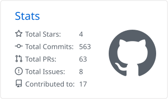
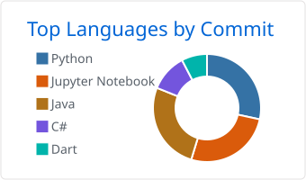
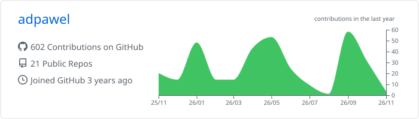

<h1 align="center">Paweł Adamczyk</h1>
 

  

---
 
### About Me
 
I'm a student focused on the intersection of **Computer Science** and **Intelligent Systems**. I'm passionate about building efficient software and exploring the depths of machine learning.
 
* 💼 **Software Engineer Intern** at 
* 🌱 Currently learning: **Backend System Design** & **OpenAI API** integration

### Core Tech Stack
 

  

### GitHub Stats
 

  <picture>
    <source media="(prefers-color-scheme: dark)" srcset="https://raw.githubusercontent.com/adpawel/adpawel/main/profile-summary-card-output/github_dark/3-stats.svg">
    
  </picture>
  <picture>
    <source media="(prefers-color-scheme: dark)" srcset="https://raw.githubusercontent.com/adpawel/adpawel/main/profile-summary-card-output/github_dark/2-most-commit-language.svg">
    
  </picture>
  <picture>
     <source media="(prefers-color-scheme: dark)" srcset="https://raw.githubusercontent.com/adpawel/adpawel/main/profile-summary-card-output/github_dark/0-profile-details.svg">
     
   </picture>

### Coding 

### Beyond Coding
 
* ♟️ **Chess:** [pablo_810](https://www.chess.com/member/pablo_810)
* 🏃 **Sports:** [Garmin Connect](https://connect.garmin.com/modern/profile/e0ecab38-0a26-465a-a717-55b3043cdc63)
---
 
### Connect with me
 

